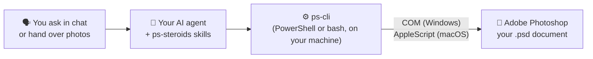

# ps-steroids

<p align="center">
  <a href="README.md">🇪🇸 Español</a> | <a href="README.en.md">🇺🇸 English</a>
</p>

<p align="center">
  
  
  
  
  <a href="LICENSE"></a>
</p>

<p align="center">
  <a href="https://github.com/kennedy122112/ps-steroids/stargazers"></a>
  
  
  
</p>

<p align="center">
  
</p>

<p align="center">
  <b>Tell it your idea or hand it your photos. Your AI agent designs in Adobe Photoshop: real, layered, editable documents.</b><br>
  Free and open source. Local, no MCP, no API key.
</p>

<p align="center"><sub>Independent project, not affiliated with Adobe. Adobe and Photoshop are trademarks of Adobe Inc.</sub></p>

---

## ✨ What it is

**ps-steroids** is a set of *skills*: instructions and tools that teach your AI assistant to work in **Adobe Photoshop**. You ask in your own words and it does the work in your open Photoshop:

- 🎨 **Designs** posts, stories, banners, flyers, covers and thumbnails from what you describe in chat, with a designer's sizes, margins and hierarchy.
- 🖼️ **Composes with your photos**: places them as smart objects, crops them to a box or a circle, removes the background and adjusts light and color.
- ✏️ **Edits** photos and PSD templates: replaces text by layer name, adds a logo or watermark, and produces the same piece in several sizes.
- 🔍 **Reads and audits** PSDs: layers, text, used and missing fonts, hidden layers. Also **without Photoshop**, using Python.
- 👀 **Checks its own work**: renders a preview, looks at it and fixes clipped text or low contrast before handing it to you.

Everything ends up as named layers: vector shapes, editable text, smart objects and adjustment layers. Each design is a single history step: **Ctrl+Z** (or **Cmd+Z**) undoes all of it.

## 🧭 How it works



Your **AI agent** (Claude Code, Codex, OpenCode or Antigravity) understands the request and writes the design as a small JSON file: layers from bottom to top, with sizes, colors and fonts. **ps-cli** builds it in your open Photoshop by running ExtendScript: through **COM** on Windows and **AppleScript** on macOS. Nothing goes through the cloud and your images never leave your machine.

## 🧰 What you need

| You need | What for | Do I have it? |
|---|---|---|
| **Windows 10/11 or macOS** | Where Photoshop runs | — |
| **Adobe Photoshop 2021 (v22) or later** | Where the design is created. "Remove Background" needs 2021+ | Creative Cloud |
| **An AI agent** | Understanding your request | See [step 2](#2-pick-your-ai-agent) |
| **PowerShell 5.1** (Windows) or **bash** (macOS) | Talking to Photoshop | Ships with the OS |
| **Python 3 + psd-tools** (optional) | Only for reading PSDs without Photoshop | `python --version` |
| **Git** (optional) | Install and update with one command; without Git the ZIP is downloaded | `git --version` |

## 🚀 Step-by-step installation

### 1. Install Photoshop

If you don't have it, install it from **[Creative Cloud](https://www.adobe.com/products/photoshop.html)** (there is a free trial). Open it once, sign in and close the welcome windows. On Windows, open it normally, **not** with "Run as administrator": if Photoshop and your agent run with different privileges, they can't see each other.

### 2. Pick your AI agent

If you already use one of these, skip this step:

| Agent | Where to get it |
|---|---|
| **Claude Code** | [claude.com/claude-code](https://claude.com/claude-code) |
| **Codex** | [github.com/openai/codex](https://github.com/openai/codex) |
| **OpenCode** | [opencode.ai](https://opencode.ai) |
| **Antigravity** | [antigravity.google](https://antigravity.google) |

### 3. Install ps-steroids

**Windows**: open **PowerShell** (Start menu → type *PowerShell*), paste this command and press Enter:

```powershell
irm https://raw.githubusercontent.com/kennedy122112/ps-steroids/main/install.ps1 | iex
```

**macOS**: open **Terminal** (Spotlight → type *Terminal*), paste this command and press Enter:

```bash
curl -fsSL https://raw.githubusercontent.com/kennedy122112/ps-steroids/main/install.sh | bash
```

It downloads to `~/.ps-steroids` and links it into every agent you have installed. When it finishes you'll see the list of agents and **"ps-steroids instalado"**.

### 4. Ask for your first design

Open Photoshop and, in a **new session** of your agent, type:

> *Connect to Photoshop and make me a square Instagram post for a free workshop on AI at work: dark blue background, a big white title and a yellow button that says "Sign up today".*

You'll see the document and its layers appear in Photoshop. The agent renders a preview, checks it and hands you the editable `.psd` and a `.png` ready to post.

On **macOS**, the first time the system asks whether your agent or Terminal may control Photoshop: answer **OK**.

**To update** later, repeat step 3 and open a new session.

## 💬 Example requests

| What you say | What you get |
|---|---|
| *"make a story announcing Thursday's webinar, with this photo of the speaker"* | A 1080 × 1920 with the cropped photo, title, date and call to action inside the safe zones |
| *"remove the background from this product photo and put it on a brand gradient"* | The product cut out with an editable mask over a gradient, with a soft shadow |
| *"change the texts in this template: title, date and venue"* | The template with the new text in its layers, and a warning if a layer doesn't exist |
| *"also make it as a LinkedIn banner and a YouTube thumbnail"* | The same piece recomposed for each format, not stretched |
| *"add my logo and a watermark to these 30 photos"* | The processed photos in a new folder, originals untouched |
| *"which fonts does this PSD use and which am I missing?"* | Fonts per layer and the ones not installed, even with Photoshop closed |
| *"review this design before I send it to print"* | A report: resolution, text off the canvas, hidden layers, contrast, font sizes |

## ❓ FAQ

**Does it cost anything?**
ps-steroids is free and open source (MIT license). Photoshop is a paid Adobe product (with a free trial), and your AI agent may have a cost depending on its plan.

**Do my images leave my computer?**
ps-steroids talks to Photoshop on your machine and connects to no service. But your AI agent sends what you type, and the images or previews it looks at, to its model provider (Anthropic, OpenAI, Google, etc.). If you work with confidential material, check your organization's and provider's policies.

**Does it work on a Mac?**
Yes. On macOS it uses AppleScript instead of COM; the commands and skills are the same.

**Does it generate images with AI?**
No. It composes with your photos, shapes, gradients and type. Photoshop's Generative Fill (Firefly) can't be used from scripts.

**Can I paste the image in the chat?**
The agent can see it, but Photoshop needs a file on disk: give it the path or save it in the project folder.

**Does it touch my original files?**
No. It works on copies and exports to new files. It doesn't delete your layers or files without your confirmation.

## 🩺 Troubleshooting

| Symptom | What to do |
|---|---|
| The agent says **Photoshop isn't open** but it is (Windows) | Photoshop was opened as administrator and the agent wasn't (or vice versa). Open it normally. |
| Error **-1743** or "not authorized" (macOS) | Missing permission: System Settings → Privacy & Security → Automation → tick Adobe Photoshop under your agent or Terminal. |
| The agent keeps waiting | Photoshop has a dialog open (sign-in, what's new, missing fonts): close it. |
| The agent **doesn't know the skills** | Repeat step 3 and open a new session. |
| Arial shows up instead of your font | The font isn't installed on your machine. Install it or ask for another; the agent tells you when it substitutes one. |
| The agent can't reach Photoshop from **Codex** | Codex runs in a sandbox by default: give it full access for these tasks. |

## ⚠️ Limitations

- **Version 0.2: not yet tested against real Photoshop.** The generated code is validated (syntax and a full run against a Photoshop mock), but Photoshop's internal actions may need adjustments. If something fails, open an issue with the JSON it returned.
- It doesn't generate photos or illustrations; Generative Fill and other Firefly features aren't available to scripts.
- Only fonts installed on your machine are used.
- The `inspect` preview (without Photoshop) is approximate: it doesn't reproduce every layer effect.
- Exports PNG, JPG and PSD; WebP and SVG not yet.

---

## 🛠️ For developers

### Other ways to install

```bash
git clone https://github.com/kennedy122112/ps-steroids.git
cd ps-steroids
powershell -NoProfile -ExecutionPolicy Bypass -File install.ps1   # Windows
bash install.sh                                                   # macOS
```

If the repository lives outside `~/.ps-steroids`, the installer creates that link to it. `-Uninstall` (Windows) or `--uninstall` (macOS) removes the links without deleting files.

### Where it installs

| Agent | Path | Tested |
|---|---|---|
| Claude Code | `~/.claude/skills/ps-*` | Installed, not yet tested with Photoshop |
| Codex | `~/.agents/skills/ps-*` | Installed, not yet tested with Photoshop |
| OpenCode | `~/.config/opencode/skills/ps-*` | Installed, not yet tested with Photoshop |
| Antigravity | `~/.gemini/antigravity/skills/ps-*` | Installed, not yet tested with Photoshop |

Each path is a link (a junction on Windows, a symlink on macOS) to the same folder: an improvement reaches every agent.

### Skills

| Skill | What for |
|---|---|
| `ps-setup` | Checks Photoshop (version, COM or AppleScript, permissions) and the bridge |
| `ps-connect` | Connects to the open Photoshop and sets the working document |
| `ps-design` | Designs new pieces from an idea or your images: formats, design criteria and spec |
| `ps-edit` | Edits images and templates: crops, background, text, logo, multiple sizes, batches |
| `ps-read` | Reads, audits and documents PSDs, with or without Photoshop |

### ps-cli

Also usable without an agent: `bin/ps-cli.ps1 <command>` on Windows and `bin/ps-cli.sh <command>` on macOS, with the same options. All output is JSON.

| Command | What for |
|---|---|
| `status` | Is Photoshop installed and open? Version and documents |
| `open -Path file [-Launch]` | Opens an image or PSD |
| `read [-Depth 4]` | Active document: size, layers, text, fonts |
| `fonts -Query text` | Searches installed fonts by name (returns the PostScript name) |
| `build -Spec design.json [-Launch]` | Builds the layered design, in a new document or the active one (a single history step) |
| `preview -Path preview.png [-MaxSize 1200]` | Flattened, downsized preview for review |
| `export -Path out.png\|jpg\|psd [-Quality 90]` | Exports (PNG and JPG as a copy; PSD saves the document) |
| `jsx -Script file.jsx` | Runs your own ExtendScript with the ps-cli helpers |
| `inspect -Path file.psd [-Preview preview.png]` | Reads a PSD **without Photoshop** (Python + psd-tools) |

`-DryRun` prints the generated ExtendScript without touching Photoshop. The spec format (fill, gradient, rect, ellipse, text, image, group; shadows, strokes, adjustments, clipping masks) is in [`skills/ps-design/SKILL.md`](skills/ps-design/SKILL.md), and there is a full example in [`examples/post-evento/spec.json`](examples/post-evento/spec.json).

### Repository layout

| Path | Contents |
|---|---|
| `bin/ps-cli.ps1` | COM bridge for Windows |
| `bin/ps-cli.sh` | AppleScript bridge for macOS |
| `bin/jsx/` | ExtendScript shared by both bridges (one file per command + `lib.jsx`) |
| `bin/psd_read.py` | PSD reader without Photoshop (psd-tools) |
| `skills/` | The five skills (`SKILL.md`) |
| `install.ps1`, `install.sh` | Installers for every agent |
| `examples/`, `docs/` | Example spec and banner |

### Design decisions

- ExtendScript is ES3 and has no `JSON`: `lib.jsx` ships its own serializer and the spec goes in as an object literal.
- Vector shapes and paragraph text are measured differently depending on document resolution: `build` works at 72 ppi and restores the resolution at the end without resampling, so spec pixels are real pixels.
- `build` runs inside `suspendHistory`: the whole design is one history step.
- Layers are always created at the top of their container (`move` + `PLACEATBEGINNING`), so the spec order is the panel order even though Photoshop creates layers next to the active one.
- Images come in as smart objects (`Plc `) and are scaled with `cover`/`contain`; `cover` adds a mask to the box.
- On macOS the code goes through `do javascript` from a temp file read as UTF-8, so accents and quotes survive.
- `.gitattributes` pins LF for `.sh`, `.jsx` and `.py`, so they work on a Mac even when edited on Windows.

## 🔗 Sibling projects

- [**ea-steroids**](https://github.com/kennedy122112/ea-steroids): model architecture in Enterprise Architect from your AI agent.
- [**figma-steroids**](https://github.com/kennedy122112/figma-steroids): design in Figma Desktop from your AI agent, no API key or MCP.
- [**bizagi-steroids**](https://github.com/kennedy122112/bizagi-steroids): describe a process and get the BPMN for Bizagi plus its Word document.
- [**blender-steroids**](https://github.com/kennedy122112/blender-steroids): model 3D scenes in Blender from your AI agent.

## 📄 License

[MIT](LICENSE)
