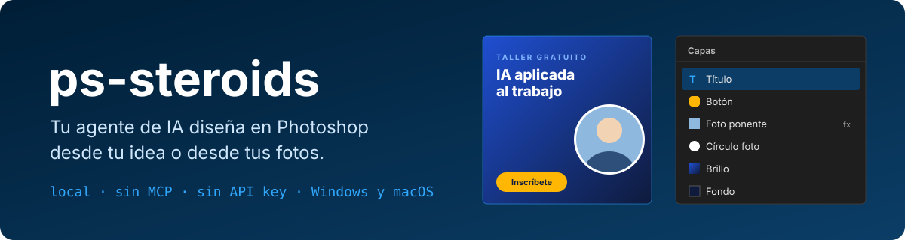
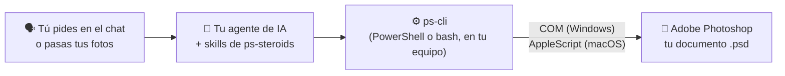

# ps-steroids

<p align="center">
  <a href="README.md">🇪🇸 Español</a> | <a href="README.en.md">🇺🇸 English</a>
</p>

<p align="center">
  
  
  
  
  <a href="LICENSE"></a>
</p>

<p align="center">
  <a href="https://github.com/kennedy122112/ps-steroids/stargazers"></a>
  
  
  
</p>

<p align="center">
  
</p>

<p align="center">
  <b>Cuéntale tu idea o pásale tus fotos. Tu agente de IA diseña en Adobe Photoshop: documentos reales, por capas y editables.</b><br>
  Gratis y de código abierto. Local, sin MCP y sin API key.
</p>

<p align="center"><sub>Proyecto independiente, no afiliado a Adobe. Adobe y Photoshop son marcas de Adobe Inc.</sub></p>

---

## ✨ Qué es

**ps-steroids** es un conjunto de *skills*: instrucciones y herramientas que le enseñan a tu asistente de IA a trabajar en **Adobe Photoshop**. Le pides lo que necesitas con tus palabras y lo hace en tu Photoshop abierto:

- 🎨 **Diseña** posts, stories, banners, flyers, portadas y miniaturas a partir de lo que describes por chat, con medidas, márgenes y jerarquía de un diseñador.
- 🖼️ **Compone con tus fotos**: las coloca como objetos inteligentes, las recorta en caja o en círculo, les quita el fondo y ajusta luz y color.
- ✏️ **Edita** fotos y plantillas PSD: cambia textos por nombre de capa, pone logo o marca de agua y saca la misma pieza en varios tamaños.
- 🔍 **Lee y audita** PSD: capas, textos, fuentes usadas y faltantes, capas ocultas. También **sin Photoshop**, con Python.
- 👀 **Revisa su propio trabajo**: saca una vista previa, la mira y corrige textos cortados o poco contraste antes de entregártelo.

Todo queda en capas con nombre: formas vectoriales, texto editable, objetos inteligentes y capas de ajuste. Cada diseño es un solo paso del historial: **Ctrl+Z** (o **Cmd+Z**) lo deshace entero.

## 🧭 Cómo funciona



Tu **agente de IA** (Claude Code, Codex, OpenCode o Antigravity) entiende lo que pides y escribe el diseño como un pequeño archivo JSON: capas de abajo hacia arriba, con medidas, colores y fuentes. **ps-cli** lo construye en el Photoshop que tienes abierto ejecutando ExtendScript: por **COM** en Windows y por **AppleScript** en macOS. No pasa por la nube y tus imágenes no salen de tu equipo.

## 🧰 Qué necesitas

| Necesitas | Para qué | ¿Lo tengo? |
|---|---|---|
| **Windows 10/11 o macOS** | Donde corre Photoshop | — |
| **Adobe Photoshop 2021 (v22) o posterior** | Donde se crea el diseño. "Quitar fondo" necesita 2021+ | Creative Cloud |
| **Un agente de IA** | Entender tu pedido | Ver el [paso 2](#2-elige-tu-agente-de-ia) |
| **PowerShell 5.1** (Windows) o **bash** (macOS) | Hablar con Photoshop | Vienen con el sistema |
| **Python 3 + psd-tools** (opcional) | Solo para leer PSD sin Photoshop | `python --version` |
| **Git** (opcional) | Instalar y actualizar con un comando; sin Git se descarga el ZIP | `git --version` |

## 🚀 Instalación paso a paso

### 1. Instala Photoshop

Si no lo tienes, instálalo desde **[Creative Cloud](https://www.adobe.com/products/photoshop.html)** (hay prueba gratuita). Ábrelo una vez, inicia sesión y cierra las ventanas de bienvenida. En Windows, ábrelo normal, **sin** "Ejecutar como administrador": si Photoshop y tu agente corren con permisos distintos, no se ven.

### 2. Elige tu agente de IA

Si ya usas uno de estos, sáltate este paso:

| Agente | Dónde conseguirlo |
|---|---|
| **Claude Code** | [claude.com/claude-code](https://claude.com/claude-code) |
| **Codex** | [github.com/openai/codex](https://github.com/openai/codex) |
| **OpenCode** | [opencode.ai](https://opencode.ai) |
| **Antigravity** | [antigravity.google](https://antigravity.google) |

### 3. Instala ps-steroids

**Windows**: abre **PowerShell** (menú Inicio → escribe *PowerShell*), copia este comando y pulsa Enter:

```powershell
irm https://raw.githubusercontent.com/kennedy122112/ps-steroids/main/install.ps1 | iex
```

**macOS**: abre la **Terminal** (Spotlight → escribe *Terminal*), copia este comando y pulsa Enter:

```bash
curl -fsSL https://raw.githubusercontent.com/kennedy122112/ps-steroids/main/install.sh | bash
```

Lo descarga en `~/.ps-steroids` y lo enlaza en cada agente que tengas instalado. Al terminar verás la lista de agentes y **"ps-steroids instalado"**.

### 4. Pide tu primer diseño

Abre Photoshop y, en una **sesión nueva** de tu agente, escribe:

> *Conecta con Photoshop y hazme un post cuadrado para Instagram de un taller gratuito de IA aplicada al trabajo: fondo azul oscuro, título grande en blanco y un botón amarillo que diga "Inscríbete hoy".*

Verás aparecer el documento con sus capas en tu Photoshop. El agente saca una vista previa, la revisa y te entrega el `.psd` editable y el `.png` para publicar.

En **macOS**, la primera vez el sistema pregunta si tu agente o la Terminal puede controlar Photoshop: responde **Aceptar**.

**Para actualizar** más adelante, repite el paso 3 y abre una sesión nueva.

## 💬 Ejemplos de pedidos

| Lo que dices | Lo que obtienes |
|---|---|
| *"hazme una story para anunciar el webinar del jueves, con esta foto del ponente"* | Un 1080 × 1920 con la foto recortada, título, fecha y llamada a la acción dentro de las zonas seguras |
| *"quítale el fondo a esta foto del producto y ponla sobre un degradado de la marca"* | El producto recortado con máscara (editable) sobre un degradado, con sombra suave |
| *"cambia los textos de esta plantilla: título, fecha y lugar"* | La plantilla con los textos nuevos en sus capas, y aviso si alguna capa no existe |
| *"sácalo también en formato banner de LinkedIn y miniatura de YouTube"* | La misma pieza recompuesta para cada formato, no estirada |
| *"ponle mi logo y una marca de agua a estas 30 fotos"* | Las fotos procesadas en una carpeta nueva, sin tocar los originales |
| *"¿qué fuentes usa este PSD y cuáles me faltan?"* | La lista de fuentes por capa y las que no están instaladas, aunque Photoshop esté cerrado |
| *"revisa este diseño antes de mandarlo a imprimir"* | Un informe: resolución, textos fuera del lienzo, capas ocultas, contraste, tamaños de letra |

## ❓ Preguntas frecuentes

**¿Cuesta algo?**
ps-steroids es gratuito y de código abierto (licencia MIT). Photoshop es un producto de pago de Adobe (con prueba gratuita), y tu agente de IA puede tener costo según su plan.

**¿Mis imágenes salen de mi computadora?**
ps-steroids habla con Photoshop en tu equipo y no se conecta a ningún servicio. Pero tu agente de IA envía lo que escribes, y las imágenes o vistas previas que mira, al proveedor de su modelo (Anthropic, OpenAI, Google, etc.). Si trabajas con material confidencial, revisa las políticas de tu organización y de tu proveedor.

**¿Funciona en Mac?**
Sí. En macOS usa AppleScript en lugar de COM; los comandos y las skills son los mismos.

**¿Genera imágenes con IA?**
No. Compone con tus fotos, formas, degradados y tipografía. El relleno generativo de Photoshop (Firefly) no se puede usar desde scripts.

**¿Puedo pegar la imagen en el chat?**
El agente la puede ver, pero Photoshop necesita un archivo en disco: dale la ruta o guárdala en la carpeta del trabajo.

**¿Toca mis archivos originales?**
No. Trabaja sobre copias y exporta a archivos nuevos. No borra capas ni archivos tuyos sin que se lo confirmes.

## 🩺 Solución de problemas

| Síntoma | Qué hacer |
|---|---|
| El agente dice que **Photoshop no está abierto** y sí lo está (Windows) | Photoshop se abrió como administrador y el agente no (o al revés). Ábrelo normal. |
| Error **-1743** o "not authorized" (macOS) | Falta el permiso: Ajustes del Sistema → Privacidad y seguridad → Automatización → marca Adobe Photoshop bajo tu agente o la Terminal. |
| El agente se queda esperando | Photoshop tiene una ventana abierta (inicio de sesión, novedades, fuentes que faltan): ciérrala. |
| El agente **no conoce las skills** | Repite el paso 3 y abre una sesión nueva. |
| Aparece Arial en vez de tu fuente | La fuente no está instalada en tu equipo. Instálala o pide otra; el agente te avisa cuando la sustituye. |
| El agente no llega a Photoshop desde **Codex** | Codex corre en un sandbox por defecto: dale acceso completo para estas tareas. |

## ⚠️ Limitaciones

- **Versión 0.2: todavía no se ha probado con Photoshop real.** El código generado está validado (sintaxis y una ejecución completa contra una imitación de Photoshop), pero las acciones internas de Photoshop pueden necesitar ajustes. Si algo falla, abre un issue con el JSON que devolvió.
- No genera fotos ni ilustraciones; Generative Fill y otras funciones de Firefly no están disponibles por script.
- Usa solo las fuentes instaladas en tu equipo.
- La vista previa de `inspect` (sin Photoshop) es aproximada: no reproduce todos los efectos de capa.
- Exporta PNG, JPG y PSD; WebP y SVG todavía no.

---

## 🛠️ Para desarrolladores

### Otras formas de instalar

```bash
git clone https://github.com/kennedy122112/ps-steroids.git
cd ps-steroids
powershell -NoProfile -ExecutionPolicy Bypass -File install.ps1   # Windows
bash install.sh                                                   # macOS
```

Si el repositorio queda fuera de `~/.ps-steroids`, el instalador crea ese enlace hacia él. `-Uninstall` (Windows) o `--uninstall` (macOS) quita los enlaces sin borrar archivos.

### Dónde se instala

| Agente | Ruta | Probado |
|---|---|---|
| Claude Code | `~/.claude/skills/ps-*` | Instalado, sin probar con Photoshop |
| Codex | `~/.agents/skills/ps-*` | Instalado, sin probar con Photoshop |
| OpenCode | `~/.config/opencode/skills/ps-*` | Instalado, sin probar con Photoshop |
| Antigravity | `~/.gemini/antigravity/skills/ps-*` | Instalado, sin probar con Photoshop |

Cada ruta es un enlace (junction en Windows, enlace simbólico en macOS) a la misma carpeta: una mejora llega a todos los agentes.

### Skills

| Skill | Para qué |
|---|---|
| `ps-setup` | Comprueba Photoshop (versión, COM o AppleScript, permisos) y el puente |
| `ps-connect` | Conecta con Photoshop abierto y fija el documento de trabajo |
| `ps-design` | Diseña piezas nuevas desde una idea o desde tus imágenes: formatos, criterios de diseño y spec |
| `ps-edit` | Edita imágenes y plantillas: recortes, fondo, textos, logo, varios tamaños, lotes |
| `ps-read` | Lee, audita y documenta PSD, con Photoshop o sin él |

### ps-cli

Se usa también sin agente: `bin/ps-cli.ps1 <comando>` en Windows y `bin/ps-cli.sh <comando>` en macOS, con las mismas opciones. Toda salida es JSON.

| Comando | Para qué |
|---|---|
| `status` | ¿Photoshop instalado y abierto?, versión y documentos |
| `open -Path archivo [-Launch]` | Abre una imagen o PSD |
| `read [-Depth 4]` | Documento activo: medidas, capas, textos, fuentes |
| `fonts -Query texto` | Busca fuentes instaladas por nombre (devuelve el nombre PostScript) |
| `build -Spec diseño.json [-Launch]` | Crea el diseño por capas, en un documento nuevo o en el activo (un solo paso del historial) |
| `preview -Path vista.png [-MaxSize 1200]` | Vista plana reducida para revisar |
| `export -Path salida.png\|jpg\|psd [-Quality 90]` | Exporta (PNG y JPG como copia; PSD guarda el documento) |
| `jsx -Script archivo.jsx` | Ejecuta ExtendScript propio con los helpers de ps-cli |
| `inspect -Path archivo.psd [-Preview vista.png]` | Lee un PSD **sin Photoshop** (Python + psd-tools) |

`-DryRun` escribe el ExtendScript generado sin tocar Photoshop. El formato del spec (fill, gradient, rect, ellipse, text, image, group; sombras, trazos, ajustes, máscaras de recorte) está en [`skills/ps-design/SKILL.md`](skills/ps-design/SKILL.md), y hay un ejemplo completo en [`examples/post-evento/spec.json`](examples/post-evento/spec.json).

### Estructura del repo

| Ruta | Contenido |
|---|---|
| `bin/ps-cli.ps1` | Puente COM para Windows |
| `bin/ps-cli.sh` | Puente AppleScript para macOS |
| `bin/jsx/` | ExtendScript compartido por los dos puentes (un archivo por comando + `lib.jsx`) |
| `bin/psd_read.py` | Lector de PSD sin Photoshop (psd-tools) |
| `skills/` | Las cinco skills (`SKILL.md`) |
| `install.ps1`, `install.sh` | Instaladores para todos los agentes |
| `examples/`, `docs/` | Spec de ejemplo y banner |

### Decisiones de diseño

- ExtendScript es ES3 y no trae `JSON`: `lib.jsx` incluye un serializador propio y el spec entra como literal de objeto.
- Las formas vectoriales y el texto de párrafo se miden distinto según la resolución del documento: `build` trabaja a 72 ppp y restaura la resolución al final sin remuestrear, así los píxeles del spec son píxeles reales.
- `build` corre dentro de `suspendHistory`: todo el diseño es un solo paso del historial.
- Las capas se crean siempre arriba de su contenedor (`move` + `PLACEATBEGINNING`), así el orden del spec es el orden del panel aunque Photoshop cree la capa junto a la activa.
- Las imágenes entran como objetos inteligentes (`Plc `) y se escalan con `cover`/`contain`; `cover` añade una máscara a la caja.
- En macOS el código va por `do javascript` desde un archivo temporal leído como UTF-8, para no romper tildes ni comillas.
- `.gitattributes` fija LF en `.sh`, `.jsx` y `.py`, para que funcionen en Mac aunque se editen en Windows.

## 🔗 Proyectos hermanos

- [**ea-steroids**](https://github.com/kennedy122112/ea-steroids): modela arquitectura en Enterprise Architect desde tu agente de IA.
- [**figma-steroids**](https://github.com/kennedy122112/figma-steroids): diseña en Figma Desktop desde tu agente de IA, sin API key ni MCP.
- [**bizagi-steroids**](https://github.com/kennedy122112/bizagi-steroids): describe un proceso y obtén el BPMN para Bizagi y su documento Word.
- [**blender-steroids**](https://github.com/kennedy122112/blender-steroids): modela escenas 3D en Blender desde tu agente de IA.

## 📄 Licencia

[MIT](LICENSE)
